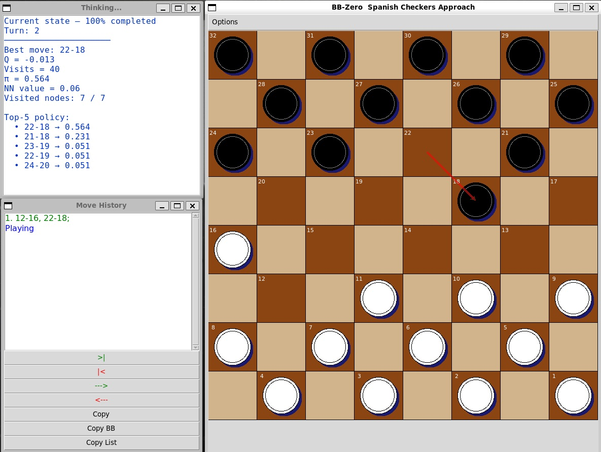

## BB‑Zero — Project Overview

BB‑Zero is an AlphaZero‑style engine for Spanish checkers, using PUCT, Monte Carlo Tree Search, Dirichlet noise, temperature, and pure self‑play reinforcement learning with no heuristics. The first full version of the program was completed on January 16, 2026. The next phase now begins: generating all training datasets from scratch and documenting the entire process as the project evolves.

The engine is written 100% in Python as a single .py file and is compatible with both Linux and Windows. BB‑Zero includes three integrated modes: Play Mode, Dataset Creation Mode, and Training Mode.

My long‑term goal is clear: **to challenge and eventually defeat Profound**, one of the strongest Spanish checkers engines documented on **Herson P. Guier’s Spanish Checkers Programs** page:  
https://damasclasicas.blogspot.com/

The project is estimated to be completed around **January 2027**.

---

## Current Status

During 2026, I continued refining and validating the BB‑Zero training pipeline. Earlier in the year, I fixed several issues affecting self‑play data generation and training consistency, resulting in cleaner datasets and more stable learning behavior. 

On November 1, 2026, I completed a major update to BB‑Zero's policy representation. The network output was expanded to a 1024‑action policy space, allowing the engine to represent the complete action space directly. Several legacy functions from earlier versions of the engine were removed during this transition. 

BB‑Zero now applies legal‑move masking over the full 1024‑action policy, ensuring that policy inference, MCTS, and training all use the same action representation. The training pipeline can also use either an unlimited training window or a bounded window of up to two million self‑play games. In parallel, I developed and integrated a search structure inspired by AlphaZero's persistent tree architecture while remaining significantly faster and more memory‑efficient in practice. 

Training will continue throughout November, December, and January using approximately 800 simulations per move to accumulate additional self‑play data and evaluate the impact of these architectural improvements. Once the new network reaches sufficient strength, I plan to run evaluation matches against Matilde from Checkersboard to measure progress and establish a performance benchmark.

---

## GUI Video

A short demonstration of the BB‑Zero GUI is available here: (Please note: the neural network shown here has not been trained correctly yet.)

https://www.youtube.com/watch?v=9LgB3CJ3WV4

---

## Release Plan

Once training is completed, BB‑Zero will be released as a Windows executable (~180 MB) together with its neural network *La_Marioneta* (~15 MB), allowing anyone to play with it.

---

## Acknowledgments

Special thanks to **Herson P. Guier**, my consultant and rule expert, whose deep knowledge of Spanish checkers has been essential to this project.

**Author:** Alberto Cervantes  
**Keywords:** Spanish checkers, Spanish draughts, classical draughts, Spanish draughts engine, AlphaZero, AI, Monte Carlo, reinforcement learning, PUCT, neural networks.

---

## GUI Preview

Below is a screenshot of the current GUI: (Please note: the neural network shown here has not been trained correctly yet.)

### Gameplay Mode

