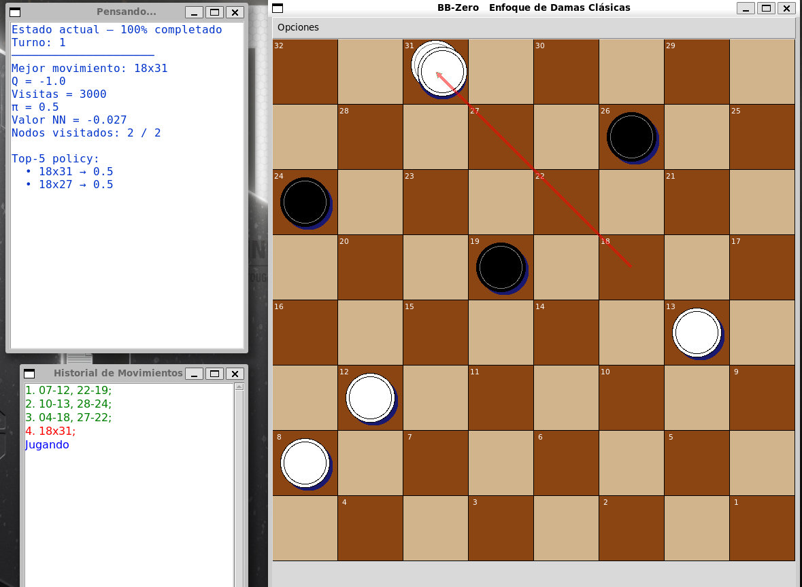

## BB‑Zero — Descripción General del Proyecto

BB‑Zero es un motor estilo AlphaZero para damas españolas, utilizando PUCT, Monte Carlo Tree Search, ruido Dirichlet, temperatura y autoentrenamiento puro sin heurísticas. La primera versión completa del programa se terminó el 16 de enero de 2026. La siguiente fase comienza ahora: generar todos los conjuntos de datos de entrenamiento desde cero y documentar todo el proceso conforme el proyecto avanza.

El motor está escrito 100% en Python dentro de un solo archivo .py y es compatible con Linux y Windows. BB‑Zero incluye tres modos integrados: Modo de Juego, Modo de Creación de Datasets y Modo de Entrenamiento.

Mi objetivo a largo plazo es claro: **desafiar y eventualmente derrotar a Profound**, uno de los motores más fuertes de damas españolas documentado en la página **Programas de Damas Clásicas de Herson P. Guier**:  
https://damasclasicas.blogspot.com/

Se estima que el proyecto estará terminado alrededor de **junio de 2026**.

---

## Estado Actual

Durante la primera mitad de 2026 continué refinando y validando todo el pipeline de entrenamiento de BB‑Zero. En junio identifiqué y corregí dos problemas críticos que habían afectado silenciosamente la calidad de los datos de self‑play: una operación de shuffle defectuosa que desalineaba los ejemplos de entrenamiento, y un conjunto de estadísticas heredadas (N/W/Q) que seguían siendo leídas desde un motor antiguo en lugar de la nueva estructura. Ambos problemas quedaron completamente resueltos el 18 de junio.

Con estas correcciones, BB‑Zero ahora produce datos de self‑play limpios, objetivos de política consistentes y un comportamiento de entrenamiento estable. Este sábado reiniciaré el entrenamiento desde cero, utilizando una ventana deslizante de 20,000 partidas, 600 simulaciones por movimiento y un esquema continuo donde cada 180 partidas nuevas reemplazan a las 180 más antiguas. Este enfoque se usará durante el resto de junio para reconstruir un conjunto de datos saludable y permitir que la red converja correctamente.

En paralelo, desarrollé una estructura similar al árbol persistente de AlphaZero, pero significativamente más rápida y eficiente en memoria. Esta arquitectura ya está completamente integrada en el motor.

A finales de junio, cuando la nueva red haya ganado fuerza, realizaré una serie de partidas de evaluación contra Matilde de Checkersboard para medir el progreso.

---

## Video de la GUI

Aquí puedes ver una demostración corta de la interfaz gráfica de BB‑Zero.  
(Nota: la red neuronal mostrada aquí aún no ha sido entrenada correctamente.)

https://www.youtube.com/watch?v=9LgB3CJ3WV4

---

## Plan de Publicación

Una vez completado el entrenamiento, BB‑Zero se publicará como un ejecutable para Windows (~180 MB) junto con su red neuronal *La_Marioneta* (~15 MB), permitiendo que cualquiera pueda jugar con él.

---

## Agradecimientos

Agradecimientos especiales a **Herson P. Guier**, mi consultor y experto en reglas, cuyo profundo conocimiento de las damas españolas ha sido esencial para este proyecto.

**Autor:** Alberto Cervantes  
**Palabras clave:** damas españolas, Spanish checkers, damas clásicas, motor de damas, AlphaZero, IA, Monte Carlo, reinforcement learning, PUCT, redes neuronales.

---

## Vista Previa de la GUI

A continuación se muestra una captura de pantalla de la GUI actual.  
(Nota: la red neuronal mostrada aquí aún no ha sido entrenada correctamente.)

### Modo de Juego

